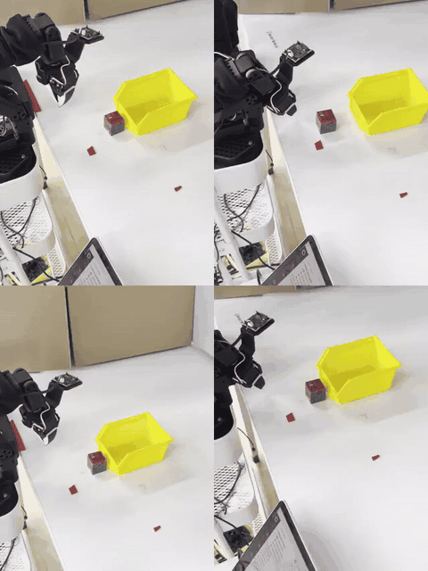
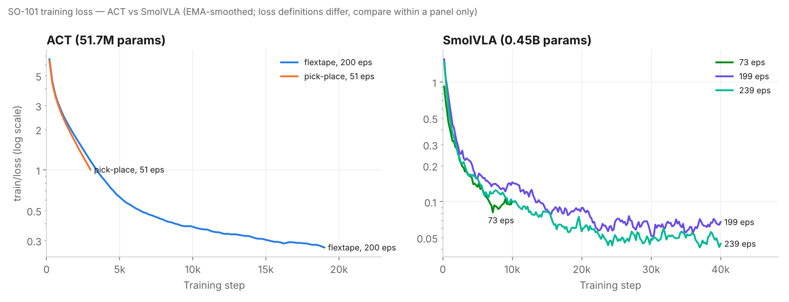
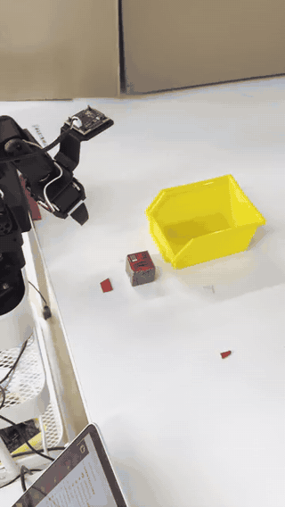

# SO-101 Imitation Learning: from ACT to SmolVLA

Teaching a low-cost **SO-101** robot arm to pick up objects and place them in a box, using **teleoperated demonstrations** and the **LeRobot** framework. The project covered the whole loop: data collection, training, and testing on the real robot, first with **ACT** (51.7M params) and then with the vision-language-action model **SmolVLA** (~0.45B params).

*Built during a summer internship, June 2026.*

<p align="center">
  <br>
  <sub>ACT policy running autonomously on the real robot, cube at different start positions (1.5× speed)</sub>
</p>

## At a glance

| | |
|---|---|
| Robot | SO-101 arm (6-DoF incl. gripper), leader–follower teleoperation |
| Framework | [LeRobot](https://github.com/huggingface/lerobot) (dataset format v3.0) |
| Demonstrations | **671 unique episodes**, ~417k frames (~3.9 h at 30 fps) |
| Policies | ACT (ResNet-18 backbone) and SmolVLA (SmolVLM2-500M backbone + action expert) |
| Experiments | 69 training runs tracked in Weights & Biases |
| Compute | Local Mac (MPS) for the first runs, then cloud GPU (Colab) |
| Real-robot result | 13 of 15 filmed ACT trials succeeded (see [Results](#results) for caveats) |

## Timeline

| Date | Step |
|---|---|
| Jun 2–3 | Set up the arm and LeRobot. Recorded the first grab-cube datasets and trained ACT on a Mac (MPS). Moved training to a cloud GPU: ~20k steps went from ~4.3 h to ~1.1 h |
| Jun 3–4 | ACT on fixed-position grasping (50 eps), then tape tasks (`tapesplit`, `fixedtape`) |
| Jun 5–6 | ACT on the flexible-position task, with the object placed anywhere in the workspace (100 eps + a separate 20-episode validation set) |
| Jun 7 | Scaled the flexible-position data to 200 episodes |
| Jun 8 | First SmolVLA attempt on 51 pick-and-place episodes (batch size 64) crashed early; trained ACT on the same data instead |
| Jun 10–12 | SmolVLA on *"put the small cube into the yellow box"*, growing the dataset 73 → 157 → 199 → 239 episodes |

## Data

All data was collected by teleoperation with a leader arm, at 30 fps with two cameras.

**ACT, flexible-position tape task** (front + overhead cameras, ~25 s episodes):
```
act_so101_flextape_200mergeset (200)
├── act_so101_flextape_dataset   (100)
├── act_so101_flextape_70dataset  (80)
└── act_so101_flextape_valiset    (20)   ← held out when training the 100-episode model
```

**SmolVLA, "put the small cube into the yellow box"** (overhead + wrist cameras):
```
vla_239mergeset (239)
├── vla_199mergeset (199)
│   ├── vla_157mergeset (157)
│   │   ├── vla_mergeset1 (73)   = 6 object positions (A–F) × 2 recording rounds
│   │   ├── vla_42_v1     (42)
│   │   ├── vla_21_v1     (21)
│   │   └── vla_21_v2     (21)
│   └── vla_42_v2 (42)
└── vla_40initial (40)
```
To build `vla_mergeset1`, I recorded each of 6 object positions (A–F) in two rounds and merged them, leaving out one round (position B, round 2) for quality.

I traced the merges afterwards by fingerprinting episodes (frame count + per-episode state statistics) across all 42 dataset repos. This also turned up 4 duplicate uploads, which I excluded from the 671-episode count.

## Training setup

| | ACT | SmolVLA |
|---|---|---|
| Parameters | 51.7M | ~0.45B |
| Vision | ResNet-18 (ImageNet) | SmolVLM2-500M-Video-Instruct, **frozen** |
| Trained parts | full model | action expert only (`train_expert_only`) |
| Action chunk | 100 steps | 50 steps |
| Batch size | 8 | 36 |
| Optimizer | AdamW, lr 1e-5 | AdamW, lr 1e-4, cosine decay with 1k warmup |
| Image augmentation | off | on (color jitter, sharpness, small affine) |
| Steps | 19k–40k | 40k |
| Inputs | 2 cameras (640×480) + 6-D joint state | 2 cameras + 6-D state + language instruction |

## Results

### Training curves

<p align="center"></p>

- **ACT**: loss fell from ~6.6 to 0.25 over 19k steps on 200 episodes. The high starting value comes from the KL term of ACT's CVAE.
- **SmolVLA**: all three dataset sizes converged smoothly. The 199- and 239-episode runs mostly plateaued after ~20k steps, so longer training gave little extra.
- These are **training** losses, and ACT and SmolVLA use different loss definitions, so values should only be compared within a panel. A lower loss on a bigger dataset does not by itself mean a better robot policy.

### Real-robot behaviour (ACT)

I filmed 15 autonomous ACT trials on the real arm. In **13 of 15** the cube ended up in the box. At least 2 of those 13 needed one or more re-grasps. In the other 2 trials the clip ends before the task finishes, both with the cube far from the box.

<p align="center">
  <br>
  <sub>Closed-loop recovery: the first grasp misses, the policy re-approaches and completes the task (2× speed)</sub>
</p>

**Caveat:** these are the videos I recorded, not a systematic evaluation with a fixed protocol. Treat 13/15 as an observation, not a measured success rate.

**Failure mode I observed:** when the cube starts far from the positions most common in the demonstrations, the gripper often closes slightly off-target and has to retry several times.

### What I did not get to

- **No real-robot evaluation of SmolVLA.** I trained the SmolVLA models but did not record or score their rollouts before the internship ended.
- **No fixed evaluation protocol.** A proper next step would be N trials per position with a defined success criterion, plus offline action-prediction error on the held-out validation set across the saved checkpoints.

## Repository contents

| File | What it covers |
|---|---|
| [`01_set_up.md`](01_set_up.md) | Hardware and LeRobot setup |
| [`02_data_collection.md`](02_data_collection.md) | Teleoperation and recording datasets |
| [`03_train.md`](03_train.md) | Training commands and configs |
| [`04_test.md`](04_test.md) | Running a policy on the robot |

## Links

- Models and datasets (Hugging Face collection): https://huggingface.co/collections/ziyiweng/so-101-imitation-learning-act-smolvla
- SmolVLA code: https://github.com/ziyiweng/smolvla-so101

## Acknowledgements

Built on [LeRobot](https://github.com/huggingface/lerobot), [ACT](https://tonyzhaozh.github.io/aloha/) (Zhao et al., 2023) and [SmolVLA](https://huggingface.co/papers/2506.01844) (Shukor et al., 2025).
